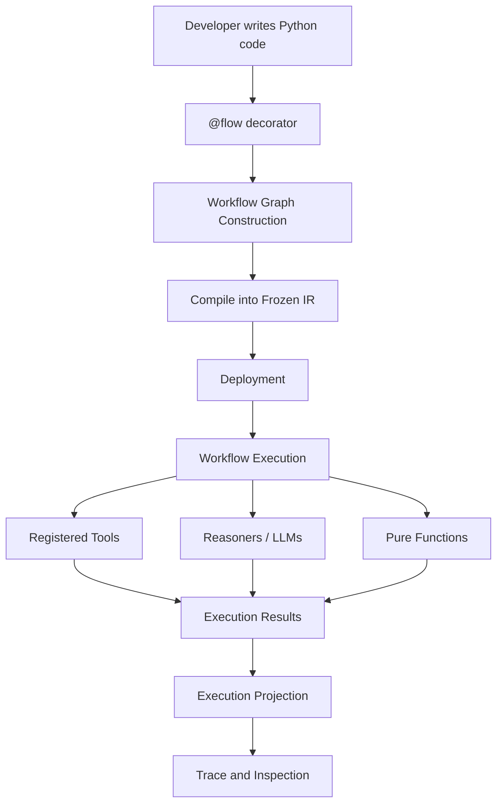
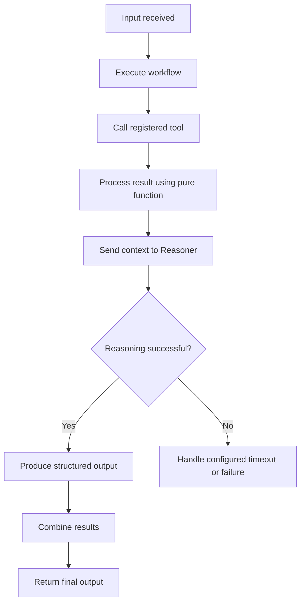
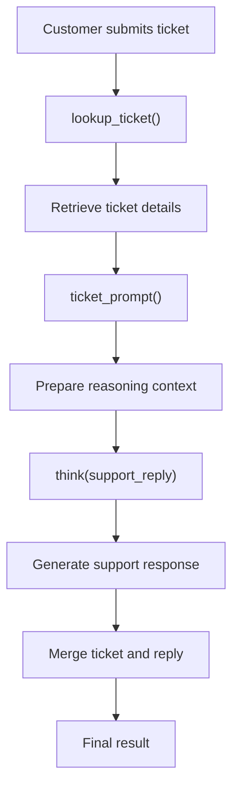
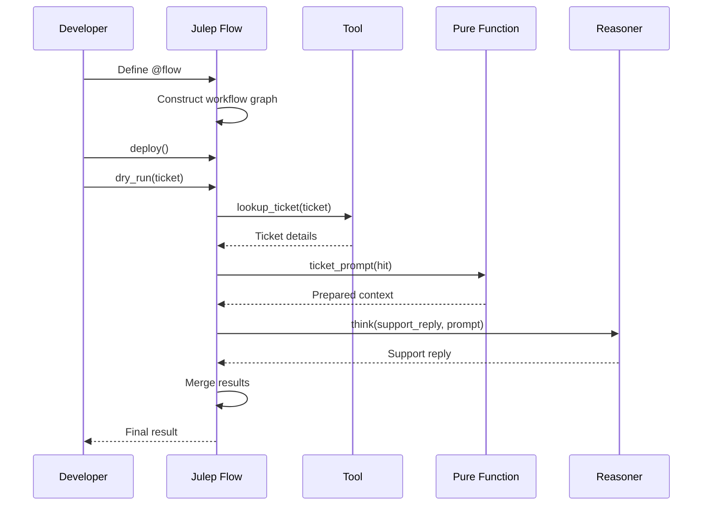
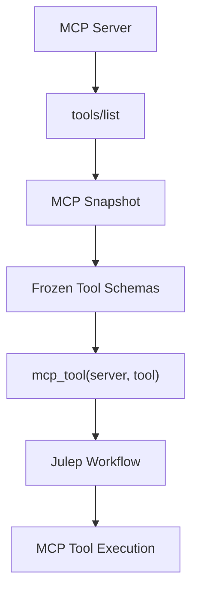
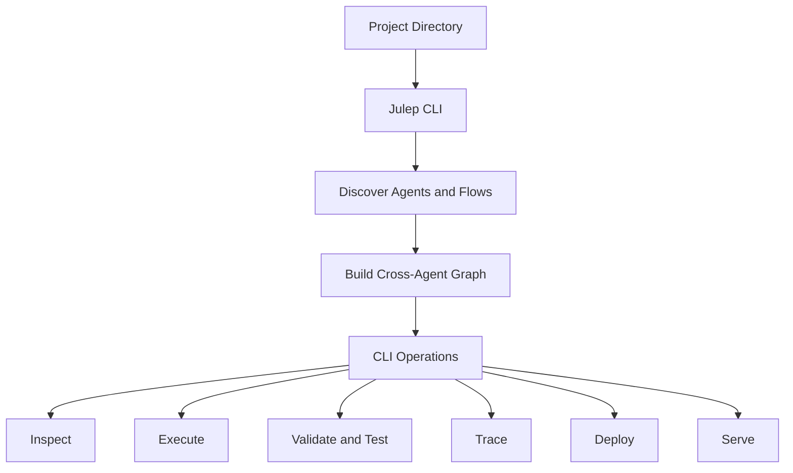
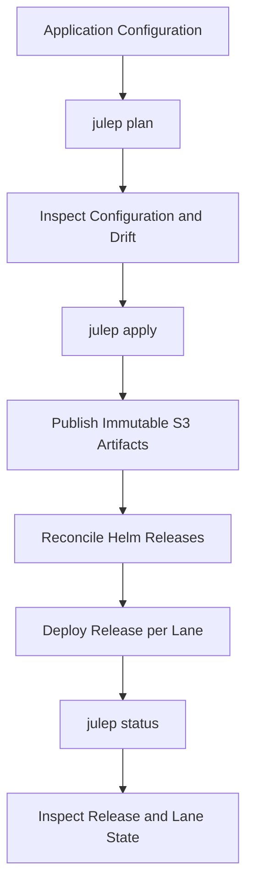
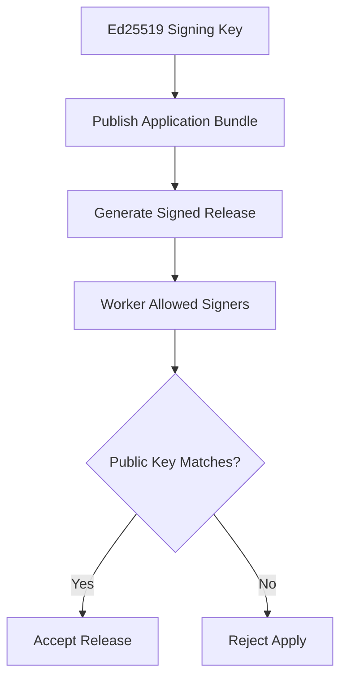

# Julep

<p align="center">
  **Durable, Composable AI Agents**
  
  Build AI agent workflows that crash, resume, retry safely, and explain every step.
</p>

---

## Overview

**Julep** is a framework for building reliable, composable AI agents using structured workflows called **dataflows**.

Instead of building AI agents with complicated, ad-hoc loops, Julep lets developers define workflows using ordinary Python functions. These workflows are then compiled into a structured, frozen Intermediate Representation (IR) that describes exactly how the agent should execute.

Julep is designed to make AI workflows:

- **Durable:** Workflows can crash and resume without losing their execution state.
- **Reliable:** Steps support retries and timeouts to handle failures.
- **Explainable:** Every execution step can be inspected through a derived projection.
- **Secure:** Agents can only access explicitly authorized tools.
- **Composable:** Tools, reasoning models, conditional branches, and other operations can be combined into larger workflows.

### Why Julep?

Traditional AI agents often rely on loops that repeatedly call an LLM and execute tools. While this approach is flexible, it can become difficult to manage when workflows involve multiple steps, failures, retries, and external services.

Julep takes a different approach: **define the workflow first, then execute it through a structured graph.**

| Traditional Agent Loops | Julep |
|---|---|
| Ad-hoc execution logic | Structured dataflow graphs |
| Difficult to recover from failures | Durable execution with crash recovery |
| Manual retry handling | Built-in retry configuration |
| Difficult to trace execution | Inspectable execution projections |
| Tools may be dynamically accessible | Explicit tool authorization |
| Complex workflow orchestration | Composable Python-based authoring |

---

## Architecture

Julep separates workflow definition from workflow execution.

The developer defines a workflow using `@flow`. Registered tools, pure functions, reasoning operations, branches, and other workflow operations are translated into graph steps.

These steps are compiled into a frozen wire-format Intermediate Representation (IR).

### High-level architecture



### Main components

| Component | Purpose |
|---|---|
| `@flow` | Defines a workflow and constructs its execution graph. |
| `@tool` | Registers functions that perform external or operational actions. |
| `@pure` | Registers deterministic data-processing functions. |
| `Reasoner` | Defines an LLM-based reasoning component. |
| `think()` | Adds a reasoning operation to a workflow. |
| `cond()` | Adds conditional execution. |
| `switch()` | Adds multi-branch execution. |
| `each()` | Adds fan-out or iteration over items. |
| `reschedule()` | Adds a rescheduling operation. |
| `deploy()` | Freezes the workflow's explicitly declared tool and reasoner surface. |
| `dry_run()` | Executes workflows locally using in-memory tools and fake reasoners. |

### How workflow execution works



The graph is constructed when the `@flow` function is defined. Registered operations append graph steps instead of performing their actual runtime work during graph construction.

The pure core of Julep remains dependency-free, while runtime integrations such as Temporal are optional.

---

## Installation

Install Julep using pip:

```bash
pip install --pre julep
```

**Why `--pre`?**

Julep 3 is currently distributed as a release candidate. Therefore, the `--pre` flag is required to install it.

Once version `3.0.0` becomes final, this flag will no longer be necessary.

---

## Quickstart

Build and execute your first Julep workflow in approximately 10 minutes.

This example demonstrates a simple customer-support ticket triage system.

**No API key is required for this example**, because the reasoning component is replaced with a deterministic fake reasoner during local execution.

### What are we building?

The workflow:

1. Receives a customer-support ticket.
2. Looks up the ticket information.
3. Extracts the relevant context.
4. Passes the context to a reasoning component.
5. Generates a support reply.
6. Combines the results and returns the final output.

### Workflow diagram



### Step 1: Import the required components

```python
from typing import TypedDict

from julep import Reasoner, deploy, flow, pure, think, tool
```

These imports provide the components needed to define, construct, and deploy the workflow.

### Step 2: Define the output structure

```python
class SupportReply(TypedDict):
    reply: str
```

`TypedDict` specifies the expected structure of the reasoning output.

Here, the response must contain a `reply` field of type `str`.

### Step 3: Create a registered tool

```python
@tool(effect="read", idempotent=True)
def lookup_ticket(ticket: str) -> dict[str, str]:
    return {
        "ticket": ticket,
        "queue": "billing",
        "summary": "Use the duplicate-charge runbook.",
    }
```

The `@tool` decorator registers this function as a workflow tool.

**Understanding its parameters:**

- `effect="read"`: Declares the tool's effect as a read operation.
- `idempotent=True`: Declares that repeating the operation is safe.
- `ticket`: The input received from the workflow.

The function returns the ticket identifier, its support queue, and a summary.

### Step 4: Create a pure function

```python
@pure("ticket_prompt")
def ticket_prompt(hit: dict[str, str]) -> dict[str, str]:
    return {
        "queue": hit["queue"],
        "context": hit["summary"],
    }
```

A pure function transforms data without performing external actions.

In this example, it extracts the relevant ticket information and prepares it for the reasoning component.

### Step 5: Define the Reasoner

```python
support_reply = Reasoner(
    name="support_reply",
    model="anthropic:claude-haiku-4-5-20251001",
    system="Draft one concise support reply as JSON.",
    reply=SupportReply,
)
```

A `Reasoner` defines the LLM-based reasoning component.

It specifies:

- Its name.
- The model to use.
- The system instruction.
- The expected output structure.

The output follows the `SupportReply` schema.

### Step 6: Define the workflow

```python
@flow
def triage(ticket: str) -> dict[str, str]:
    hit = lookup_ticket(
        ticket,
        retries=2,
        timeout_s=5
    )

    prompt = ticket_prompt(hit)

    answer = think(
        support_reply,
        prompt,
        timeout_s=10
    )

    return hit | answer
```

This is the main workflow.

**Execution breakdown:**

| Operation | What happens |
|---|---|
| `lookup_ticket()` | Retrieves ticket information. |
| `retries=2` | Configures two retries. |
| `timeout_s=5` | Sets a five-second timeout. |
| `ticket_prompt()` | Extracts and prepares context. |
| `think()` | Invokes the reasoning component. |
| `timeout_s=10` | Sets the reasoning timeout. |
| `hit \| answer` | Merges the two dictionaries. |

The `|` operator merges records, while `h["key"]` can be used to extract individual fields from data handles.

### Step 7: Create a fake reasoning function

```python
def fake_support_reply(value: dict[str, str]) -> SupportReply:
    return {
        "reply": f"{value['queue']}: {value['context']}"
    }
```

This function simulates the output of the reasoning component.

It allows the workflow to be tested locally without making an actual LLM API call.

### Step 8: Deploy and execute

```python
deployment = deploy(
    triage,
    tools=[lookup_ticket],
    reasoners=[support_reply]
)

result = deployment.dry_run(
    "Customer was charged twice.",
    reasoners={
        "support_reply": fake_support_reply
    }
)

print(result.value)
```

`deploy()` freezes the workflow's explicitly declared tools and reasoners.

`dry_run()` executes the workflow locally using in-memory tools and the supplied fake reasoner.

### Expected output

```text
{
    'ticket': 'Customer was charged twice.',
    'queue': 'billing',
    'summary': 'Use the duplicate-charge runbook.',
    'reply': 'billing: Use the duplicate-charge runbook.'
}
```

### What happens behind the scenes?



**Important:** `@flow` executes once during definition time using data handles to construct the graph. Registered tools, registered pures, `think()`, `cond()`, `switch()`, `each()`, and `reschedule()` append graph steps rather than performing their actual runtime operations at that point.

For larger examples, refer to:

- `examples/episode_summary_flow.py`
- `examples/cluster_labeling_flow.py`

---

## MCP Integration

Julep supports Model Context Protocol (MCP) references inside workflows.

Use:

```python
mcp_tool(server, tool)
```

This creates an MCP tool reference inside `@flow`.

### How MCP integration works



The tool's schemas and behavior contract come from a frozen MCP snapshot.

Handle-valued keyword arguments build the MCP tool's input record directly.

For a working example, see:

`examples/episode_summary_flow.py`

It demonstrates snapshot-backed MCP reads and writes using a local `mcp_call` fake.

---

## Production Secrets and MCP Security

Julep provides security mechanisms for managing production secrets and controlling which tools agents can access.

### 1. Write-only operator vault

The self-hosted control plane includes a write-only operator vault.

- Secret values are encrypted at rest.
- Callers can bind short-lived, per-run credentials.
- Secrets can be referenced using `secret://name` in MCP headers.

### 2. Secure secret handling

Secret values:

- Travel only in encrypted Temporal payloads.
- Are excluded from stored run data.
- Are excluded from execution projections.

### 3. MCP tool-surface validation

Before user effects occur, worker-side MCP preflight checks the frozen, transitively reachable tool surface.

New releases use exact `pin` comparison by default.

The available policy modes are:

| Mode | Purpose |
|---|---|
| `pin` | Exact tool-surface comparison; default. |
| `names` | Explicit names-based comparison. |
| `off` | Disables the comparison. |

If a tool is removed during execution or its schema is rejected after validation, execution fails terminally with typed surface drift.

For complete configuration details, refer to the [Control Plane Guide](docs-site/content/docs/deploy/control-plane.md).

---

## Julep CLI

Julep provides a developer CLI for managing an entire module of agents.

Its approach can be described as **"dbt for agents, terminal-native."**

Instead of managing individual workflows separately, the CLI discovers all `@flow` and `Agent(...)` definitions within a directory and treats them as nodes in a cross-agent graph.

### CLI architecture



### Common commands

| Command | Description |
|---|---|
| `julep ls` | Lists agents with their names, kinds, and tags. |
| `julep show triage` | Displays an agent's kind, source location, tags, and calls. |
| `julep graph` | Displays the cross-agent DAG in Graphviz DOT format. |
| `julep run triage --input '"TICKET-42"'` | Executes an agent locally and streams its trace tree. |
| `julep lint +triage` | Validates an agent and its dependencies. |
| `julep test triage` | Runs pytest for selected agents. |
| `julep trace <run-id>` | Displays a cached execution trace and Langfuse link. |
| `julep doctor` | Checks discovery, secrets, Git, Langfuse, and Temporal configuration. |
| `julep deploy triage --env staging` | Freezes, publishes, and records a deployment. |
| `julep serve api --migrate` | Runs the self-hosted FastAPI control plane. |

### Agent selection

Julep supports composable selectors for selecting agents.

| Selector | Meaning |
|---|---|
| `tag:support` | Selects agents with the support tag. |
| `state:modified` | Selects modified agents for Slim-CI. |
| `+agent` | Graph traversal from the selected agent. |
| `agent+` | Graph traversal using the corresponding selector syntax. |
| `@agent` | Alternative graph traversal selector. |
| `a,b` | Intersection of selections. |
| `--exclude` | Excludes selected agents. |

For complete details, see the [CLI Guide](docs-site/content/docs/guides/using-the-cli.md).

---

## Application-Level Deployment

For production applications, Julep supports an explicit `Application` object rather than requiring a second discovery convention.

### Defining an application

```python
from collections.abc import Mapping

from julep import (
    Application,
    CapabilityManifest,
    McpSnapshot,
    PipelineSpec,
)


def load_live_memory_tools_snapshot(
    environment: Mapping[str, str],
) -> McpSnapshot:
    # Use the selected deployment environment to call tools/list.
    ...


application = Application("memory", [
    PipelineSpec(
        name="episode_summary",
        flow=summary_flow,
        reasoners=(summary_reasoner,),
        capabilities=CapabilityManifest.from_file(
            "summary-capabilities.yaml"
        ),
        lane="summary",
        eval_packages=("prompts/episode_summary.ctx",),
        snapshot=memory_tools_snapshot,
        snapshot_source=load_live_memory_tools_snapshot,
    ),
])
```

### Understanding the configuration

| Component | Purpose |
|---|---|
| `Application` | Defines the overall application. |
| `PipelineSpec` | Defines an individual deployable pipeline. |
| `flow` | References the workflow to execute. |
| `reasoners` | Declares the reasoning components. |
| `capabilities` | Loads the capability manifest. |
| `lane` | Identifies the execution lane. |
| `eval_packages` | Specifies evaluation packages. |
| `snapshot` | Provides the MCP snapshot. |
| `snapshot_source` | Loads the live MCP snapshot from the selected environment. |

### Environment configuration

Point `[tool.julep].application` to the application object using a `module:attribute` value.

Each deployable environment must also specify the worker's explicit context factory.

Example `pyproject.toml` configuration:

```toml
[tool.julep.env.staging]
temporal_address = "temporal-frontend.temporal.svc.cluster.local:7233"
release_store = "s3://julep-releases/julep"
worker_image = "registry.example/memory@sha256:<digest>"
worker_context_factory = "memory.worker:build_context"
worker_service_account = "julep-worker"
worker_priority_class = "julep-model-worker"
payload_encryption_secret = "temporal-payload-codec"

[tool.julep.env.staging.worker_environment]
MEMORY_TOOLS_MCP_URL = "http://memory-tools/mcp-internal"
JULEP_BUNDLE_ALLOWED_SIGNERS = "<64-hex-ed25519-public-key>"

[tool.julep.env.staging.worker_secret_environment.MEMORY_TOOLS_JWT_PRIVATE_KEY]
secret_name = "memory-tools-jwt"
key = "private-key"
```

### Important configuration details

**Worker environment**

The `worker_environment` section contains ordinary environment variables available to the worker.

**Worker secret environment**

The `worker_secret_environment` section references Kubernetes Secrets rather than storing their actual values.

For example:

```toml
[tool.julep.env.staging.worker_secret_environment.MEMORY_TOOLS_JWT_PRIVATE_KEY]
secret_name = "memory-tools-jwt"
key = "private-key"
```

Here, the worker obtains the private key from the specified Kubernetes Secret.

**Priority class**

`worker_priority_class` is optional.

Set it only when the shared cluster infrastructure provides the specified PriorityClass. The EKS demo provides it, but ordinary clusters may not.

**Payload encryption**

`payload_encryption_secret` is required for application releases.

It identifies an existing Kubernetes Secret in `kubernetes_namespace` containing:

- `keyring`
- `active-key-id`

---

## Application Deployment Lifecycle

Julep provides three main application-level deployment operations.



### 1. Plan

```bash
julep plan --env staging
```

Reports differences involving:

- Application artifacts.
- MCP schemas.
- Helm and KEDA configuration.
- Runtime configuration.

### 2. Apply

```bash
julep apply --env staging
```

Publishes an immutable S3 artifact-store release and reconciles:

- One digest-pinned Helm release per lane.
- An immutable release-specific task queue.

This operation does not change traffic.

To skip Helm reconciliation:

```bash
julep apply --env staging --publish-only
```

### 3. Status

```bash
julep status --env staging
```

Aggregates the release state and live lane state.

The application-level status path is selected only when:

1. `[tool.julep].application` is configured.
2. No selector is supplied.
3. No `--exclude` argument is supplied.

Otherwise, selected status queries continue to inspect the legacy per-agent deployment ledger.

---

## Bundle Signing and Verification

Application publishing requires an Ed25519 signing key.

### Required signing configuration

The publishing key must be a 64-hex Ed25519 seed, or a file containing one.

Set it using:

```bash
export JULEP_BUNDLE_SIGNING_KEY="<64-hex-ed25519-seed>"
```

For production, configure the corresponding 64-hex public key in the worker environment:

```toml
[tool.julep.env.staging.worker_environment]
JULEP_BUNDLE_ALLOWED_SIGNERS = "<64-hex-ed25519-public-key>"
```

### Signing workflow



If a configured allow-list does not contain the publishing key, `apply` rejects the deployment.

For read-only `plan` and application-level `status`, the public allow-list is required, with the private key available as a local fallback.

---

## Running the Julep Worker

The `julep worker` command continuously runs using its configured environment contract.

```bash
julep worker
```

By default, the worker continues serving.

### Smoke testing

To verify Temporal connectivity and test whether the configured queue can be polled:

```bash
julep worker --smoke-test-seconds 30
```

The worker:

1. Verifies Temporal connectivity.
2. Polls the configured queue for the specified duration.
3. Drains the worker.
4. Exits.

A positive value enables smoke testing. The default value of `0` keeps the worker running continuously.

---

## Optional Dependencies (Extras)

Julep's base installation provides workflow authoring and compilation functionality.

Additional runtime capabilities can be installed through optional extras.

### Installation

```bash
pip install --pre 'julep[temporal]'
```

### Available extras

| Extra | Installation | Functionality |
|---|---|---|
| Temporal | `julep[temporal]` | Durable execution through Temporal workflows, activities, workers, and client helpers. |
| DBOS | `julep[dbos]` | Durable execution using DBOS and PostgreSQL. |
| HTTP | `julep[http]` | Native HTTP tool calls through the `callTool` activity. |
| CMA | `julep[cma]` | HTTPX transport for the CMA HTTP adapter. |
| MCP | `julep[mcp]` | Official MCP SDK, HTTPX, PyJWT, cryptography, MCP references, snapshots, calls, and authentication. |
| Server | `julep[server]` | FastAPI/Uvicorn control plane, SSE, PostgreSQL store, Temporal gateway, cryptography, and HTTPX. |
| Dotctx | `julep[dotctx]` | Rich `.ctx` layout with Jinja2 templates compiled into registered renderers. |
| Providers | `julep[providers]` | Multi-provider `LlmCaller` through any-llm. |
| OpenTelemetry | `julep[otel]` | OpenTelemetry span export of execution projections. |
| Langfuse | `julep[langfuse]` | Langfuse OTLP/HTTP export of execution projections. |
| Store | `julep[store]` | Artifact distribution stores and bundle-signing primitives. |
| WASM | `julep[wasm]` | Sandboxed WASM execution of bundle-sourced pure functions using the Wasmtime host. |

### Multiple extras

Multiple extras can be installed together:

```bash
pip install --pre 'julep[store,temporal,mcp,server]'
```

Install additional provider-specific extras when using the providers integration.

**Note:** `julep.HAVE_TEMPORAL` indicates whether the Temporal runtime is available.

Julep can still import and compile workflows even when Temporal is not installed.

Native `!? $env.get(...)` settings support in `.ctx` does not require an additional extra.

---

## Julep v1 vs Julep 3

Julep 3 is a complete ground-up rewrite of the original Julep v1.

They are different products with different architectures.

| Julep v1 | Julep 3 |
|---|---|
| Original agents API platform | Durable, composable dataflow framework |
| Previous architecture | Ground-up rewrite |
| Preserved separately | Current v3 development line |
| No direct migration path | Independent implementation |

### Where can I find Julep v1?

Julep v1 remains available through:

- [Julep v1 GitHub Branch](https://github.com/julep-ai/julep/tree/v1)
- [Julep v1 Documentation](https://v1.docs.julep.ai)

**Important:** There is no migration path between Julep v1 and Julep 3. They are different products.

---

## Project Structure and Further Reading

Useful examples and documentation included in the repository:

| Resource | What it covers |
|---|---|
| `examples/episode_summary_flow.py` | Workflow composition and MCP snapshot-backed operations. |
| `examples/cluster_labeling_flow.py` | Larger workflow example. |
| `docs-site/content/docs/deploy/control-plane.md` | Production secrets, MCP policies, vault configuration, and administration API. |
| `docs-site/content/docs/guides/using-the-cli.md` | CLI commands, selectors, and usage. |

---

## License

Julep is licensed under the **Apache License 2.0**.

See the [LICENSE](LICENSE) file for details.

---

<p align="center">
  **Build reliable AI agents. Compose workflows. Execute with confidence.**
  
  Made possible with Julep.
</p>
